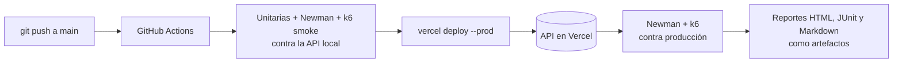

# API de cotización de envíos — pruebas de API con Newman y k6

**Actividad Grupal 2: API Testing** · Calidad y Pruebas de Software (SI-784) · Escuela Profesional de Ingeniería de Sistemas · Universidad Privada de Tacna

**Integrantes:** Milton H. Flores Chino · Manuel Andre Dongo Palza

**Video (≤ 5 min):** https://youtu.be/XAjGJB6H0Fw

**API en producción:** https://si784-api-envios.vercel.app · [contrato OpenAPI](https://si784-api-envios.vercel.app/v1/openapi.json) · [ejecuciones del pipeline](https://github.com/miltom123/si784-grupal2-api-testing/actions)

Una API REST pequeña y sin estado que cotiza envíos entre departamentos del Perú, construida para practicar **pruebas de API automatizadas**:

- **Newman** (colecciones de Postman): pruebas funcionales, de contrato, de valores límite y de errores.
- **k6**: pruebas de carga con umbrales de rendimiento.
- **GitHub Actions**: pruebas locales → despliegue en **Vercel** → las mismas pruebas contra producción.

## Arquitectura



| Pieza | Tecnología |
|---|---|
| API | Node.js 20 + [Hono](https://hono.dev) |
| Despliegue | Vercel (función Node.js) mediante GitHub Actions |
| Pruebas funcionales | Newman 6 + newman-reporter-htmlextra |
| Pruebas de carga | k6 |
| Pruebas unitarias | `node:test` |

## Endpoints

| Método | Ruta | Descripción |
|---|---|---|
| GET | `/v1/health` | Estado y versión |
| GET | `/v1/departamentos?zona=` | 25 departamentos con su zona (LIMA, COSTA, SIERRA, SELVA) |
| GET | `/v1/departamentos/{codigo}` | Un departamento (`404` si no existe) |
| GET | `/v1/limites` | Límites de peso y valor declarado |
| POST | `/v1/cotizaciones` | Cotiza un envío |
| GET | `/v1/openapi.json` | Contrato OpenAPI 3 |

Ejemplo:

```bash
curl -X POST https://<api>/v1/cotizaciones \
  -H "Content-Type: application/json" \
  -d '{"origen":"TAC","destino":"LIM","pesoKg":2.3,"servicio":"express","valorDeclarado":300}'
```

### Reglas de tarifa

- Base: S/ 8 si origen y destino están en la misma zona, S/ 12 si no.
- Peso: S/ 2.50 por cada 0.5 kg iniciado. Rango permitido: 0.1 a 50 kg.
- Recargo de S/ 5 si el origen o el destino está en la selva.
- Servicio `express`: flete × 1.6 y entrega más rápida.
- Seguro: 1 % del valor declarado (0 a 10 000).
- IGV: 18 % del subtotal.

Errores con forma única: `{ "error": { "code", "message", "campo" } }` y códigos `400`, `404`, `415` y `422`.

## Pruebas

### Newman — 22 peticiones, 121 aserciones

La colección [`tests/postman/envios.postman_collection.json`](tests/postman/envios.postman_collection.json) se genera desde [`generar-coleccion.mjs`](tests/postman/generar-coleccion.mjs) y tiene cuatro carpetas:

1. **Salud y catálogo**: estado, filtros, 400 y 404.
2. **Cotizaciones válidas**: montos exactos, esquema JSON, IGV = 18 % y total = subtotal + IGV, express más caro que estándar.
3. **Valores límite**: 0.1 kg y 50 kg aceptados; 0.09 kg, 50.01 kg y valor declarado 10 001 rechazados con 422.
4. **Errores y robustez**: códigos inválidos, campos faltantes o con tipo incorrecto, JSON mal formado (400), Content-Type incorrecto (415) y ruta inexistente (404).

### k6 — carga con umbrales

[`tests/k6/carga.js`](tests/k6/carga.js) sube de 0 a 20 usuarios virtuales en 55 s, mezcla catálogo, cotizaciones aleatorias y entradas inválidas, y falla el pipeline si no se cumple:

- `http_req_failed < 1 %`
- `p(95) de http_req_duration < 800 ms`
- `checks > 99 %`

## Ejecutar en local

```bash
npm install
npm start                 # http://localhost:3000
npm run test:unit
npm run test:api          # Newman, reportes en reports/
k6 run tests/k6/carga.js  # requiere k6 instalado
```

## Despliegue automatizado

El workflow [`ci-cd.yml`](.github/workflows/ci-cd.yml) necesita el secreto `VERCEL_TOKEN` (Vercel → Account Settings → Tokens). En cada push a `main`:

1. Corre pruebas unitarias, Newman y un smoke de k6 contra la API local.
2. Enlaza o crea el proyecto `si784-api-envios` en Vercel y despliega a producción.
3. Corre Newman y k6 contra la URL pública y publica los reportes como artefactos y en el resumen de la ejecución.
