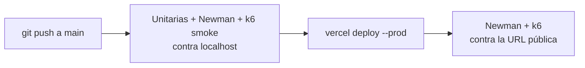

> **Actividad Grupal 2: API Testing**: Calidad y Pruebas de Software (SI-784), Universidad Privada de Tacna.
> Autores: Milton H. Flores Chino y Manuel Andre Dongo Palza.

**Repositorio:** https://github.com/miltom123/si784-grupal2-api-testing
**API en producción:** https://si784-api-envios.vercel.app
**Video (≤ 5 min):** https://youtu.be/XAjGJB6H0Fw

---

## El problema

Probar una API "a mano" con Postman sirve el primer día. Al tercer cambio ya nadie repite los 20 clics, y los errores llegan a producción. Para este trabajo nos pusimos una regla simple: **ningún cambio llega a producción si no pasan las pruebas, y las mismas pruebas se repiten contra la URL pública después de desplegar.**

Para eso construimos una API pequeña y la probamos con dos herramientas:

- **Newman**, la versión de línea de comandos de Postman. Cubre las pruebas funcionales y de contrato, y es el tema de este artículo.
- **k6** para las pruebas de carga. Mi compañero Manuel lo explica en su artículo.

## La API bajo prueba

Es una API REST sin estado que **cotiza envíos entre departamentos del Perú**. Está hecha con Node.js 20 y [Hono](https://hono.dev).

| Método | Ruta | Qué hace |
|---|---|---|
| GET | `/v1/health` | Estado y versión |
| GET | `/v1/departamentos?zona=` | 25 departamentos con su zona |
| GET | `/v1/departamentos/{codigo}` | Un departamento (404 si no existe) |
| POST | `/v1/cotizaciones` | Calcula el precio del envío |
| GET | `/v1/openapi.json` | Contrato OpenAPI 3 |

Las reglas de negocio tienen suficientes detalles para que valga la pena probarlas:

- Tarifa base de S/ 8 en la misma zona y S/ 12 entre zonas.
- S/ 2.50 por cada 0.5 kg iniciado.
- Recargo de selva, servicio express ×1.6 y seguro del 1 %.
- IGV del 18 %.

Los errores siempre tienen la misma forma:

```json
{ "error": { "code": "VALIDACION", "message": "...", "campo": "pesoKg" } }
```

Pruébala tú mismo:

```bash
curl -X POST https://si784-api-envios.vercel.app/v1/cotizaciones \
  -H "Content-Type: application/json" \
  -d '{"origen":"TAC","destino":"ARE","pesoKg":2.3}'
```

## Por qué Newman

- **La colección es un archivo JSON** versionado en el repositorio, junto al código que prueba.
- **Corre en cualquier CI** con `npx newman run`, sin abrir Postman.
- **Tiene reporteros** de consola, JUnit y HTML (`newman-reporter-htmlextra`), así los resultados quedan como artefactos del pipeline.
- **La misma colección** se ejecuta contra `localhost` y contra producción. Solo cambia la variable `baseUrl`.

## Diseño de la colección: 22 peticiones en 4 carpetas

En vez de editar a mano un JSON de 1000 líneas, la colección **se genera** con un script ([`generar-coleccion.mjs`](https://github.com/miltom123/si784-grupal2-api-testing/blob/main/tests/postman/generar-coleccion.mjs)) a partir de una lista legible de casos. Las aserciones que se repiten se escriben una sola vez:

```js
const cotizacionValida = [
  status(200),
  `pm.test('cumple el esquema de cotización', () => pm.response.to.have.jsonSchema(${s(esquemaCotizacion)}));`,
  `pm.test('IGV es el 18 % del subtotal', () => { const d = pm.response.json().desglose; pm.expect(d.igv).to.be.closeTo(d.subtotal * 0.18, 0.011); });`,
  `pm.test('total = subtotal + IGV', () => { const r = pm.response.json(); pm.expect(r.total).to.be.closeTo(r.desglose.subtotal + r.desglose.igv, 0.011); });`
];
```

Las cuatro carpetas siguen técnicas clásicas de diseño de casos:

1. **Salud y catálogo.** Health check, listado, filtro por zona en minúsculas, zona inválida (400) y departamento inexistente (404).
2. **Cotizaciones válidas (partición de equivalencia).** Misma zona, distinta zona con express, y selva con valor declarado. Cada caso verifica **montos exactos**: por ejemplo, Tacna → Arequipa con 2.3 kg debe costar **S/ 16.82**.
3. **Valores límite.** 0.1 kg y 50 kg se aceptan; 0.09 kg, 50.01 kg y un valor declarado de 10 001 devuelven `422`.
4. **Errores y robustez.** Campos faltantes, tipo incorrecto (`"2"` en lugar de `2`), JSON mal formado (400), `Content-Type: text/plain` (415) y ruta inexistente (404).

### Tres trucos que valen la pena

**1. Validar el contrato con JSON Schema, no solo el status:**

```js
pm.test('el error sigue el contrato', () => pm.response.to.have.jsonSchema(esquemaError));
pm.test('señala el campo pesoKg', () => pm.expect(pm.response.json().error.campo).to.eql('pesoKg'));
```

**2. Aserciones a nivel de colección**, que se ejecutan después de **cada** petición:

```js
pm.test('responde en menos de 3 s', () => pm.expect(pm.response.responseTime).to.be.below(3000));
pm.test('responde JSON', () => pm.expect(pm.response.headers.get('Content-Type')).to.include('application/json'));
```

**3. Comparar dos respuestas con `pm.sendRequest`.** Probamos una propiedad del negocio, "express siempre cuesta más que estándar", lanzando una segunda petición desde el script de pruebas:

```js
pm.sendRequest({ url: pm.environment.get('baseUrl') + '/v1/cotizaciones', method: 'POST', /* ... servicio: 'express' */ },
  (err, res) => pm.test('express > estándar', () => {
    pm.expect(res.json().total).to.be.above(pm.response.json().total);
  }));
```

## Ejecutarla en local

```bash
npm install
npm start          # API en http://localhost:3000
npm run test:api   # newman + reportes HTML y JUnit en reports/
```

```
│              requests │   22 │   0 │
│            assertions │  121 │   0 │
```

## El pipeline: probar → desplegar → volver a probar

El workflow de GitHub Actions ([`ci-cd.yml`](https://github.com/miltom123/si784-grupal2-api-testing/blob/main/.github/workflows/ci-cd.yml)) tiene tres jobs encadenados:



1. **Pruebas locales.** Levanta la API dentro del runner y corre las pruebas unitarias (`node:test`), Newman y un smoke de k6.
2. **Despliegue.** Usa la CLI de Vercel con el secreto `VERCEL_TOKEN`. El job obtiene el dominio de producción desde la API de Vercel y lo expone como `output`.
3. **Pruebas contra producción.** Recibe esa URL y ejecuta **la misma colección**:

```yaml
- name: Pruebas funcionales con Newman (producción)
  run: |
    npx newman run tests/postman/envios.postman_collection.json \
      --env-var baseUrl="$BASE_URL" \
      --reporters cli,htmlextra,junit,json \
      --reporter-htmlextra-export reports/newman-produccion.html
```

Con `jq`, el resultado JSON de Newman se convierte en una tabla del resumen de la ejecución. Así se ve sin descargar nada. Los reportes HTML quedan como artefactos.

## Resultados en producción

| | Ejecutadas | Fallidas |
|---|---|---|
| Peticiones | 23 (22 + 1 `sendRequest`) | 0 |
| Aserciones | 121 | 0 |

Mientras desarrollábamos, la propia corrida de Newman detectó una aserción de `Content-Type` que se serializaba mal al generar la colección. Por eso las aserciones exactas sobre montos usan valores redondeados a centavos y `closeTo` donde hay cálculos con decimales.

## Lecciones

- **Genera la colección desde código.** Los cambios se revisan en un diff legible y nadie edita a mano el JSON exportado.
- **Prueba el contrato, no solo el status.** Un `200` con un campo de menos también es un bug.
- **Repite las pruebas después de desplegar.** Lo que pasa en `localhost` puede fallar en la plataforma, por enrutamiento, cabeceras o variables de entorno.
- **Valores límite y errores** fueron la mitad de los casos y donde aparecieron más sorpresas.

¿Y el rendimiento? Eso lo cubre k6. Lee el artículo de Manuel: _ENLACE_ARTICULO_MANUEL_.
